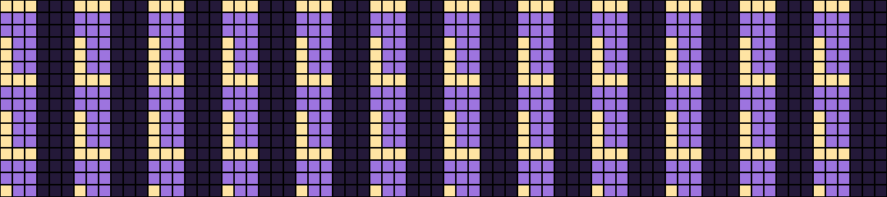
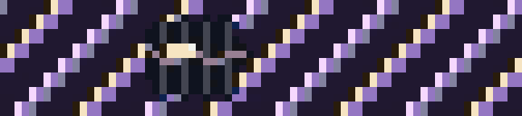

# Pixel Loom

Weave a pocket-sized pixel textile with six drafts, four palettes and an eight-piece gallery.

Turn a weave into a variation without redrawing it. The wheel changes the structure, the click changes its colours, and Start moves the threads across the 72-column display. The reverse side keeps the draft name and palette visible while the front stays all fabric.

## Choose the shape of the weave

1. Open Pixel Loom and look at the front while turning the wheel one notch at a time.
2. Watch for the change in the direction and spacing of the threads. The six drafts are Diamonds, Herringbone, Basket, Steps, Honeycomb and Ripple.
3. Stop when you see the structure you want. Read its name on the back if two small patterns look similar.



## Try another colour and shift the threads

1. Click the wheel while the draft is on screen. The palette advances without changing the selected draft.
2. In the recording the same diagonals turn from purple to blue. Tap **Start** to shift the pattern one column. Twelve shifts take it around the cycle.
3. Hold **Start** when you want a copy. Pixel Loom saves the draft, palette and phase together.



## Return to a saved piece

Hold the wheel button to enter the gallery. Turn to browse, then click a piece to put it back on the loom. Holding the wheel leaves the gallery without loading a piece. You can keep eight saved weaves. A ninth save replaces the oldest, and your current piece also survives a restart. The app runs entirely on the bar.

## Run in the emulator

Open BUSY Bar Emulator. From this repository, run:

```sh
~/.busy-emulator/bin/busy-emulator dev --once
```

Press **Back** to exit.

The GIFs are excerpts from the emulator recording. The front display is enlarged 9× and the end frames pause for reading.

[Full recording](media/controls.mp4) · [Rear display](screenshots/back-1.png) · [Firmware test](EMULATOR-QA.md) · [MIT license](LICENSE)
